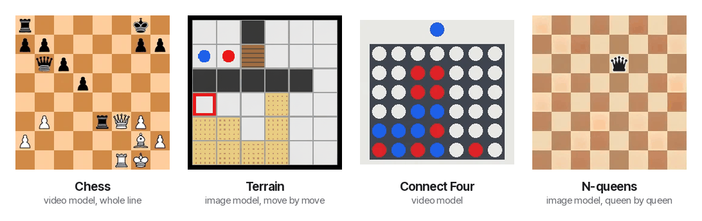
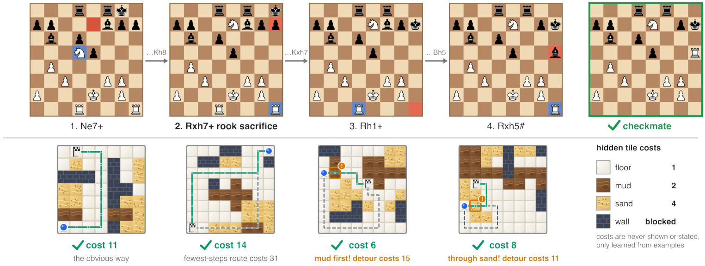
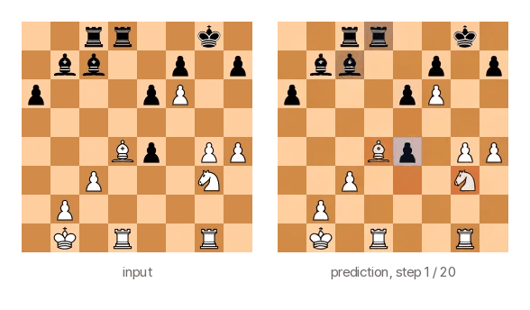
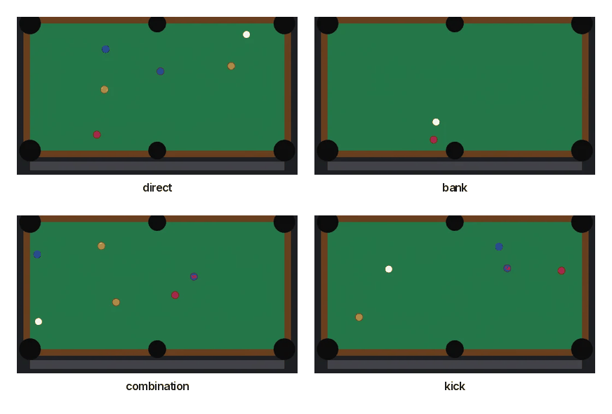

<div align="center">

# Learning the Next Best Move<br>with Visual Diffusion Models

**Amir Razlighi**<sup>1,2,3</sup> · **Ali Mahdavi Amiri**<sup>1</sup> · **Yiorgos Chrysanthou**<sup>2,3</sup> · **Andrey Voynov**<sup>4</sup> · **Daniel Cohen-Or**<sup>5</sup>

<sup>1</sup>Simon Fraser University · <sup>2</sup>University of Cyprus · <sup>3</sup>CYENS Centre of Excellence · <sup>4</sup>Google DeepMind · <sup>5</sup>Tel Aviv University

[](https://arxiv.org/abs/2611.30879)
[](https://amirhossein-razlighi.github.io/next_best_move/)
[](https://huggingface.co/AmirHossein-razlighi/next-best-move)
[](https://huggingface.co/datasets/AmirHossein-razlighi/next-best-move)
[](LICENSE)



</div>

**TL;DR.** Fine-tune a pretrained image or video diffusion model on pictures of states and their next best moves, and it
learns to choose moves whose value depends on consequences several steps ahead, with no search at inference. The state is
an image, the move is an edit of that image, and repeating the prediction solves a puzzle, a route or a game one decision
at a time.

## News

- **2026-11** The paper is on [arXiv](https://arxiv.org/abs/2611.30879). Code, all twelve checkpoints and all seven datasets
  are released.

## How it works

<p align="center"></p>

- **State as an image.** A chess board, a map, a Go board or a pool table is rendered as a picture.
- **Action as an edit.** The model draws its move into the picture: blue where a piece leaves, red where it lands (a disc
  for Connect Four, a cue stick for billiards). The move is read back from the strongest marks.
- **Two backbones.** The image model ([Qwen-Image-2.1](https://huggingface.co/Qwen/Qwen-Image-2.1) + LoRA) predicts one
  move per call. The video model ([Wan2.2-TI2V-5B](https://huggingface.co/Wan-AI/Wan2.2-TI2V-5B-Diffusers) + LoRA) draws
  several moves and the states they lead to in one clip, and the first move is played.
- **Decisions are samples.** The first denoising step already reads out the decision, often better than a fully denoised
  sample; a majority vote over a few samples helps further.

<table>
<tr>
<td width="44%" align="center"><br><sub>The move appears in the first denoising steps (image model, chess).</sub></td>
<td width="56%" align="center"><br><sub>Billiards: the video model draws the cue stick and the shot power.</sub></td>
</tr>
</table>

## Installation

Python 3.11 and CUDA GPUs (the paper used 24 GB A5000s).

```bash
git clone https://github.com/amirhossein-razlighi/next_best_move.git && cd next_best_move
uv sync && source .venv/bin/activate      # pinned versions, incl. torch (cu126) and diffusers at the tested revision
```

Without `uv`: install `torch==2.14.1` from the cu126 index, then `pip install -e .`.

Three environment variables say where things live (paths in the configs are relative to them):

| variable | default | content |
|---|---|---|
| `NBM_MODELS` | `./models` | the two base models |
| `NBM_DATA` | `./data` | one folder per task |
| `NBM_OUTPUTS` | `./outputs` | training runs and evaluations |

## Quick start

Evaluate the released chess image model on 200 test puzzles:

```bash
scripts/download_base_models.sh image        # Qwen-Image-2.1 (`video` for Wan2.2-TI2V-5B, or `all`)
scripts/download_checkpoints.sh chess_image  # -> checkpoints/chess_image
scripts/download_data.sh chess               # -> data/chess

torchrun --standalone --nproc_per_node 2 -m nbm.evaluate --config configs/chess/image.yaml \
    --checkpoint checkpoints/chess_image --split test --steps 1 --limit 200
```

This prints the next-best-move accuracy and writes `metrics.json`, `predictions.jsonl` (one record per puzzle) and a few
example pictures under `$NBM_OUTPUTS/eval/`. Leave out `--limit` for the full test set. `all` downloads every checkpoint
or dataset.

Every evaluation uses the paper's readout: the strongest marks define the move, and a move that cannot be played counts as
a failure. The options select how the model is sampled:

| option | readout |
|---|---|
| (default) | full sampling: 20 Euler steps (image model), 30 UniPC steps (video model) |
| `--steps 1` | the first denoising step only |
| `--votes n` | majority vote over n samples |

An image-model process uses two GPUs (text encoder and VAE on one, the transformer on the other), a video-model process one.
Results do not depend on the number of processes.

## Models and results

All checkpoints are on [Hugging Face](https://huggingface.co/AmirHossein-razlighi/next-best-move)
(`scripts/download_checkpoints.sh <task>_<image|video>`). Test-set numbers, seed 0; the commands for every cell are in the
task pages.

| task | metric | image | image, one step | video | video, one step | details |
|---|---|:-:|:-:|:-:|:-:|---|
| chess | next best move (10,000 puzzles) | 56.0 | **62.5** | 56.4 | **63.9** | [chess](docs/tasks/chess.md) |
| shortest path | optimal route: held-out / longer / larger maps | 88.8 / 47.0 / 79.0 | | 94.6 / 66.6 / 79.8 | | [pathfinding](docs/tasks/pathfinding.md) |
| terrain (costs never shown) | cheapest route | 87.5 | | 82.8 | | [pathfinding](docs/tasks/pathfinding.md) |
| Connect Four | keeps the win (hard positions) | 67.5 | **76.4** | 64.5 | **72.0** | [connect4](docs/tasks/connect4.md) |
| Go (19 x 19) | KataGo's move | 20.9 | **31.1** | | | [go](docs/tasks/go.md) |
| billiards | ball potted | 18.6 | **28.0** | 34.6 | **47.9** | [billiards](docs/tasks/billiards.md) |
| N-queens | next queen keeps the board solvable | 78.8 | **85.2** | | | [nqueens](docs/tasks/nqueens.md) |

With a majority vote over 8 samples, chess reaches 63.8 (image) and 65.4 (video).

## Data

All datasets are on [Hugging Face](https://huggingface.co/datasets/AmirHossein-razlighi/next-best-move)
(`scripts/download_data.sh <task>`), and every one can be rebuilt with its task's builder.

| task | config | data | external tools for building the data |
|---|---|---|---|
| chess puzzles | `configs/chess/` | Lichess puzzle database | none |
| shortest path, terrain | `configs/shortest_path/`, `configs/terrain/` | generated | none |
| Connect Four | `configs/connect4/` | generated, solver labels | Pascal Pons' solver (fetched by a build script) |
| Go | `configs/go/` | KGS games, KataGo labels | KataGo |
| billiards | `configs/billiards/` | generated, simulator labels | none (the simulator is included) |
| N-queens | `configs/nqueens/` | generated | none |

Each task page in `docs/tasks/` describes the task, the data format, how to download or build the data, and the training and
evaluation commands with the expected numbers.

## Training

```bash
torchrun --standalone --nproc_per_node <P> -m nbm.train --config configs/<task>/<image|video>.yaml [key.path=value ...]
```

Each config holds every hyper-parameter of the paper's model; `key.path=value` overrides any of them. The global batch is
`train.batch_size x train.grad_accum x` the number of processes, and the task pages give the launch that matches the paper.
A run writes `checkpoint-<step>/` (the last two are kept), a validation log, TensorBoard logs and a progress line to
`$NBM_OUTPUTS/<train.output_dir>`; `train.resume=latest` continues it. Slurm templates are in `examples/slurm/`.

## Repository

```
nbm/models/        the two backbones: loading, LoRA, flow-matching loss, samplers
nbm/train.py       training               nbm/evaluate.py   evaluation
nbm/marks.py       drawing marks and measuring their strength      nbm/readout.py   strongest-mark readout, majority vote
nbm/tasks/         one package per task; base.py is the Task interface, README.md explains how to add a task
configs/           one YAML file per model           docs/tasks/   one page per task
scripts/           downloads                         tests/        CPU tests
```

Tests run on CPU without model weights: `python -m pytest -q`.

**Your own task.** Implement the Task interface in `nbm/tasks/<name>/` (see `nbm/tasks/README.md` and the toy task in
`nbm/tasks/_example/`) and write a config; training and evaluation then work unchanged. Coding agents can start from
[`AGENTS.md`](AGENTS.md).

## Citation

```bibtex
@article{razlighi2026nextbestmove,
  title   = {Learning the Next Best Move with Visual Diffusion Models},
  author  = {Razlighi, Amir and Mahdavi Amiri, Ali and Chrysanthou, Yiorgos and Voynov, Andrey and Cohen-Or, Daniel},
  journal = {arXiv preprint arXiv:2611.30879},
  year    = {2026}
}
```

## License and acknowledgements

The code and the released weights are under the [MIT License](LICENSE). The base models keep their own licenses
(Qwen-Image-2.1: qwen-research; Wan2.2: Apache-2.0). The chess puzzles come from the
[Lichess puzzle database](https://database.lichess.org/#puzzles) (CC0), Go games from the KGS archive and Go labels from
[KataGo](https://github.com/lightvector/KataGo). Connect Four labels use
[Pascal Pons' solver](https://github.com/PascalPons/connect4) (AGPL-3.0), which the build script downloads; it is not part
of this repository, and the batch driver compiled against it is covered by the solver's license.
